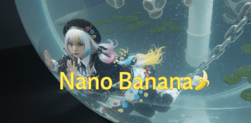
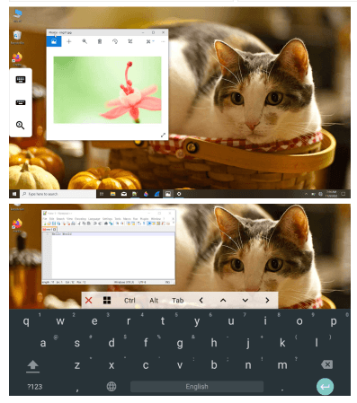
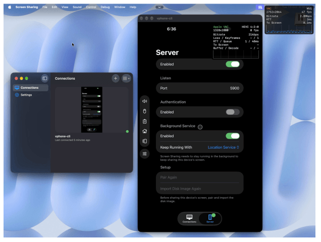
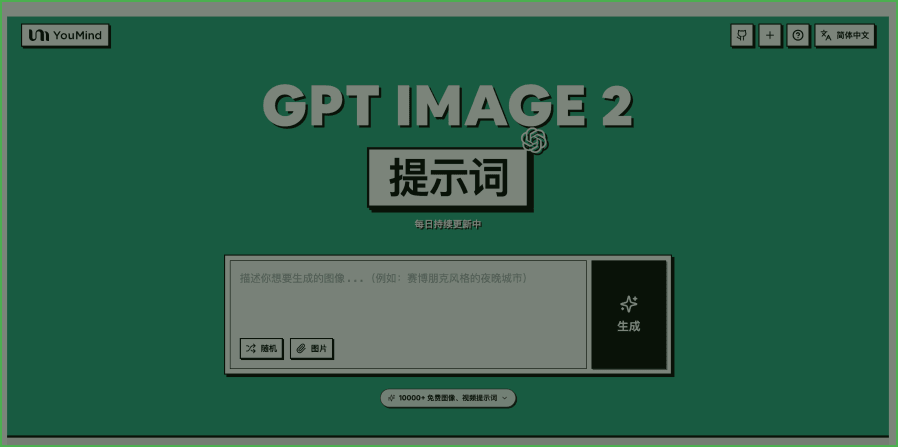
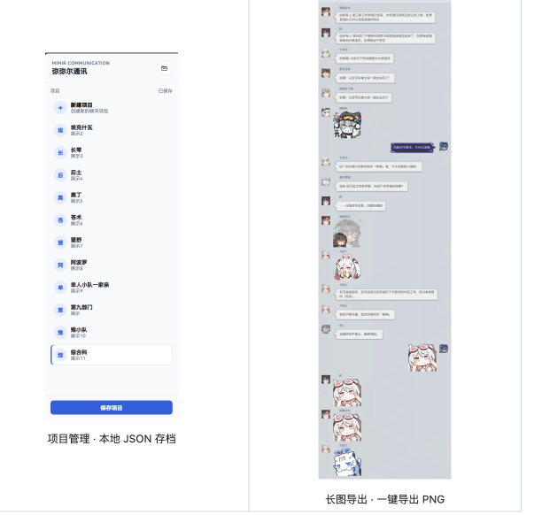
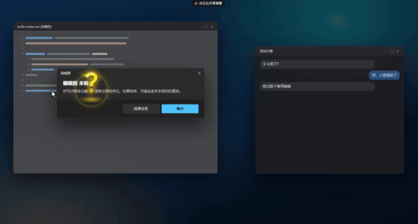

## 📕 精选文章

* 📄[绝了！Compose Multiplatform 也能实现 iOS26 液态玻璃的效果了](https://juejin.cn/post/7649288849941725193)
* 📄[ChatGPT 生图提示词图鉴：50 种风格速查 + 实战案例](https://zixungou.com/tutorials/chatgpt-image-prompt-gallery)
* 📄[别再说 Flutter 是唯一选择了——KMP 正在悄悄抢走它的地盘](https://juejin.cn/post/7623616071808139310)
* 📄[卷不动了？我写了一个 Flutter 全链路监控 SDK，从卡顿、崩溃到性能，一次性搞定！](https://juejin.cn/post/7564977973260173338)
* 📄[孩子画的小人，真的动起来了！我做了一个手绘动画小工具](https://juejin.cn/post/7697294498347761706)
* 📄[CPF-Flutter 社区提出折叠场景分栏（平行视界） 方案](https://juejin.cn/post/7685604730751057983)

## 🤖 AI前沿

**Nano Banana 动漫图转真人 cos 照总是不够真实？试试这个方法！**  

使用将步骤拆分的方法，分别生成角色图和分镜稿，最后再合并为场景图，解决某些难以一步到位转成真人 cos 照的 CG 图

https://blog.skyju.cc/post/nano-banana-anime-to-cosplay/

## 🔨 实用工具

**yihkllo/spineviewer-love**  

一个简洁、高效的 Spine/live2d 查看器，spine支持 2.1 至 4.3 全版本内容。可通过选择文件夹批量打开大量文件，实现快速预览。有古董资源或者交流的可以来yihkllo.cc
A simple and fast Spine viewer supports all content from versions 2.1 to 4.3. live2d，You can open numerous files by selecting a folder for quick viewing.

https://github.com/yihkllo/spineviewer-love

**gujjwal00/avnc**  

VNC Client for Android

https://github.com/gujjwal00/avnc

**nekohasekai/open-screen-sharing**  

开放屏幕共享旨在基于 Apple VNC（macOS 的屏幕共享服务器和 ScreenSharing.app）使用的私有协议开发卓越的服务器和客户端。
Better Screen Sharing for Apple systems

https://github.com/nekohasekai/open-screen-sharing

## 📚 宝藏资源

**Mint-ARK/Alpha-Persei-Cluster**  

针对 AetherGazer 制作的本地仿真服务端 (LocalServer)
Alpha Persei Cluster - Distribution and Release Workspace

https://github.com/Mint-ARK/Alpha-Persei-Cluster

**YouMind-OpenLab/awesome-gpt-image-2**  

🎨 OpenAI GPT Image 2 创意提示词精选集合

🚀 World's largest GPT Image 2 prompt library, updated daily — 2000+ curated prompts with preview images, 16 languages. OpenAI's next-gen image model with pixel-perfect text rendering, cross-image consistency, and commercial-grade illustration. Free & open source.

https://github.com/YouMind-OpenLab/awesome-gpt-image-2

## 🎮 好玩有趣

**DaydDream/mimirtalk-webui**  

深空之眼弥弥尔通讯风格聊天编辑器：可视化编辑对话与群聊，一键导出长图 PNG

https://github.com/DaydDream/mimirtalk-webui

**darrenprx/lolPing**  

把英雄联盟的信号和表情搬到整个桌面，支持 Windows、macOS，以及实验性的 Linux X11 版本。
League of Legends ping wheel for your Windows desktop. Hold Alt, drag, and ping anywhere, with the original animations and sounds.

https://github.com/darrenprx/lolPing

## 📝 日常记录

近期忙着好多事，总算静下心来整理下资源。因此总有种感觉年纪到了一个节点后有心而力不足的心理暗示，有好多想做的事但没办法安排在计划内。不得不服老这句话说的没错但不能成为心理暗示啊！
