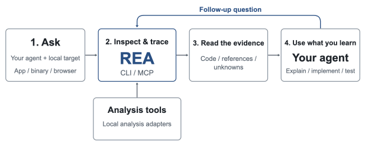
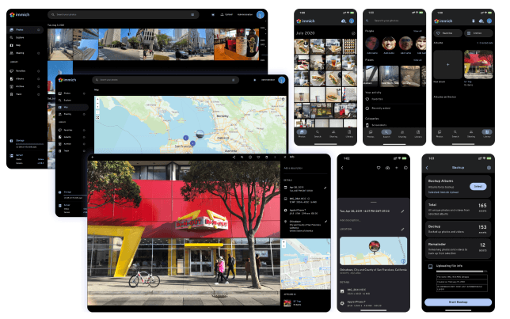
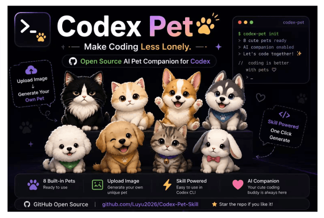
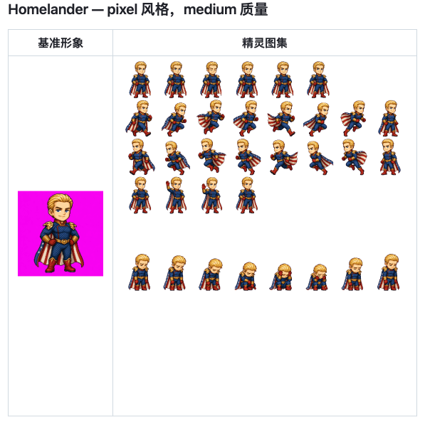

## 📕 精选文章

* 📄[苹果悄悄上线网页版 App Store！官方出品调研竞品更方便](https://juejin.cn/post/7574727105705082920)
* 📄[每天都和 AI 聊天，你可能已经是个「神经病」 | 极客公园](https://www.geekpark.net/news/355927)
* 📄[做订阅类 APP 的 7 年，我把所有经验打包成了这个 “疯狂” 的产品](https://w2solo.com/topics/5464)
* 📄[免费短剧，卖的是你那两小时](https://solo.xin/topic/6078)
* 📄[【AI大模型应用开发】1.3 Prompt攻防（安全） 和 Prompt逆向工程](https://juejin.cn/post/7353112518146097204)
* 📄[Android SDK安全加固问题与分析](https://juejin.cn/post/7249923343259910200)
* 📄[Codex Pets 宠物功能完整解读：8 个形态 + 3 种状态，与 Claude Code Buddy 对比](https://help.apiyi.com/codex-pets-vs-claude-code-buddy-feature-comparison.html)

## 🔨 实用工具

**morluto/rea**  

通过一个 MCP 服务，逆向分析二进制文件、应用程序和运行时行为。

Reverse engineer anything with agents, from app behavior down to native binaries.

https://github.com/morluto/rea

**kunkundi/crossdesk**  

轻量、跨平台的远程桌面，支持电脑、浏览器和移动端连接，用桌面墙集中查看与操控多台设备。

A lightweight, cross-platform remote desktop software with support for Web Client access

https://www.crossdesk.cn/

https://github.com/kunkundi/crossdesk

**immich-app/immich**  

高性能自托管照片和视频管理解决方案
High performance self-hosted photo and video management solution.

https://github.com/immich-app/immich

**farion1231/cc-switch**  

Claude Code、Claude Desktop、Codex、Gemini CLI、Grok Build、OpenCode、OpenClaw、Hermes Agent、Pi 和 MiniMax Code 的一体化管理器
A cross-platform desktop All-in-One assistant for Claude Code, Codex, OpenCode, OpenClaw, Grok Build & Hermes Agent. Only official website: ccswitch.io

https://github.com/farion1231/cc-switch

## 📚 宝藏资源

**独立开发者导航 | 精选工具与资源**  

IndieNav 独立开发者导航，发现精选工具与优质资源，涵盖开发工具、设计素材、产品增长、变现平台与创业服务，加速您的独立开发之旅。

https://www.indienav.com/

## 🎮 好玩有趣

**Luyu2026/Codex-Pet-Skill**  

这里集结了codex宠物的制作技巧与部分已生成的宠物合集，方便大家直接调用

https://github.com/Luyu2026/Codex-Pet-Skill

**Lawrenclia/codex_pet**  

这是一个基于 Wisdel 桌面伴侣素材制作的自定义 Codex 动画宠物。当前版本直接像素化原始 GIF 帧，尽量保留角色的橙色眼睛、表情、黑色轮廓和小比例 Q 版剪影，而不是重新绘制角色。

https://github.com/Lawrenclia/codex_pet

**Win-Hao/hatch-pet-claude**  

一个用于生成像素风动画宠物精灵图的 Claude Code 技能。输出兼容 Codex 格式的 1536x1872 精灵图集，支持多达 9 种动画状态。

Claude Code skill for generating animated pixel art pet sprites. Adapted from OpenAI Codex hatch-pet with interactive setup, preview gate, and centroid alignment.

https://github.com/Win-Hao/hatch-pet-claude

## 📝 日常记录

固态硬盘几年前才299，如今同款要899。这涨幅只感叹太离谱！